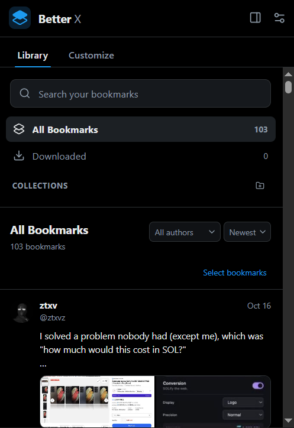
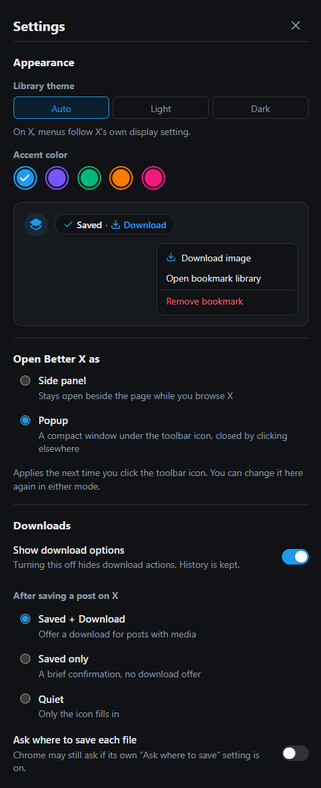

# Better X

A private, local-first Chrome extension for saving posts from X into an organized library, and downloading their photos, GIFs, and videos. Better X grew out of Saved for X 0.2.0, and also lets you clean up and adjust X itself from its side panel.

Save a post in one click. Browse, search, tag, and organize it in a side panel. Download its media at original quality. Everything stays in your browser: no account, no server, no X API.

> **Not affiliated with X Corp.** "X" and "Twitter" are trademarks of their respective owners.

## Screenshots

<p align="center">
  
  &nbsp;
  
</p>

<!-- TODO: add a screenshot of the Save and Download buttons on a post on x.com -->

## Contents

- [Screenshots](#screenshots)
- [Features](#features)
- [Install](#install)
- [Moving from Saved for X](#moving-from-saved-for-x)
- [Using it](#using-it)
- [Media downloads](#media-downloads)
- [Privacy and permissions](#privacy-and-permissions)
- [Settings](#settings)
- [Architecture](#architecture)
- [Development](#development)
- [Testing](#testing)
- [Known limitations](#known-limitations)
- [Roadmap](#roadmap)
- [License](#license)

## Features

**Saving**

- One-click save control in every post's action row, sized and aligned to X's own icons (any layout, zoom, or font size).
- Captures the post as you see it: text, author, date, photos/videos/GIFs, the quoted post, what it replies to, and link or Article previews.
- Separate from X's native bookmarks. Nothing is sent to X.

**Library**

- Side panel with full-text search, author filter, date sort, collections, tags, and private notes.
- Bulk select to move, tag, or delete, with ten-second undo.
- JSON export and validated import, including backups from Saved for X. Existing bookmarks are never overwritten by an import.

**Downloads**

- A subtle **Saved · Download** offer appears after you save a post with media. Nothing downloads unless you click it.
- Download from the saved-post menu on X, or from any card in the library.
- Original-resolution photos, GIFs (as the MP4 files X hosts), and videos where X publishes a downloadable MP4.
- Multi-image posts open a chooser with previews and **Download all**. Quoted-post media is listed separately and never downloaded silently.
- A built-in **Downloaded** collection lists posts with at least one completed download, without moving them out of their own collection.

**Customize X**

- A **Customize** tab beside the Library with 71 settings in eight groups: navigation, home and feed, posts, account insights, smart filtering, sidebar, appearance, and ads / Grok / Premium. Search them, filter by group, open and close groups. Every setting starts off.
- Changes apply to every open X tab at once, without reloading, and turning a setting off puts back what it changed. Nothing is removed from X's page; it is hidden with style rules, so nothing needs undoing.
- What it covers: hide Ads, Grok, Premium upsells and suggested accounts; trim the menu (Explore, Communities, Lists, Messages, Notifications, Bookmarks, Jobs, Premium...); hide view, reply, repost, like and bookmark counts, follower counts, verification badges and X's own action buttons (Better X's Save stays); hide reposts, the Home composer and "Show new posts"; keep only search in the sidebar or hide it; follow Following instead of For You.
- Sliders for timeline width, sidebar width, menu spacing, menu text size and post text size.
- **Quick setups**: Clean, Minimal and Focus apply a whole combination in one click, with Undo.
- **Move your setup**: Settings → Data & backup exports your switches, sliders and theme to a small JSON file and imports it elsewhere (merge or replace), with no account. It is separate from the Library backup.
- Selectors come from Control Panel for Twitter and are checked against X-shaped test pages, not live x.com, so an X redesign can make a setting do nothing; it will not hide ordinary posts. See [docs/CONTROL-PANEL-INVENTORY.md](docs/CONTROL-PANEL-INVENTORY.md) for what is and is not covered.

**Account insights and Smart filtering**

- **Account insights** (off by default): small badges after a post's @handle built from what X itself shows on a profile's “About this account” page: a flag for the country or region the account is **based in**, an Apple / Android / Web mark for how the account is **connected**, and a note when X says the location may not be accurate. Click or point at a badge for a small card (based in, connected via, joined, username changes, affiliation), with only the facts X sent.
- These are three different things and Better X keeps them apart: _based in_ is X's estimate for the account (not nationality, not where a post was written); _connected via_ is the account's platform (not the app used for one post); a location note is X's, and not proof of a VPN or of anything.
- Lookups ask x.com with your own session, the way X's own page does, are cached locally, shared between lookups of the same account, spaced out, and paused when X says to wait. By default nothing is looked up until you point at or click a badge's globe; you can choose manual, on pointer rest, or automatic for posts on screen. No third-party service, account or telemetry is involved.
- **Smart filtering** (off by default): choose countries or regions, and posts from accounts X places there are **collapsed** (with a Show post button), hidden, or highlighted. A quoted post is judged by its own author, apart from the post quoting it. **Always Show** accounts, your own posts, and the post you opened are never touched; accounts X has not answered for are never filtered. It changes only what you see.
- **Hide X Money** and **Hide Articles** remove those two menu entries and nothing else.

**Open it your way**

- Settings → **Open Better X as**: the toolbar icon opens the side panel (default) or a compact popup. The popup is the same app, and has a button to open the side panel.

**Appearance**

- Light, dark, or automatic theme, and five accent colors, applied live on X and in the library.
- Choose what happens after saving (offer a download, show a confirmation, or stay quiet) and which actions the saved-post menu shows.

## Install

Requires Node.js 20.19+ and Chrome 116+.

```bash
git clone https://github.com/ztxv/better-x.git
cd better-x
npm ci
npm run build
```

1. Open `chrome://extensions` and enable **Developer mode**.
2. Choose **Load unpacked** and select `.output/chrome-mv3`.
3. Pin the extension for one-click access to the library, then refresh any open X tab.

After each rebuild, click **Reload** on the extension card and refresh X. The version shown on the card is the one in `wxt.config.ts`.

For live development, run `npm run dev`; WXT prints the output directory to load.

## Moving from Saved for X

Better X is a separate extension with its own library; it does not read Saved for X's data on its own. Move your library with a backup file:

1. In **Saved for X**, open **Settings → Export JSON** and keep the downloaded file.
2. In **Better X**, open **Settings → Import JSON** and choose that file.

Better X imports every Saved for X backup version (1, 2, and 3) as well as its own backups. What comes across:

- bookmarks with their text, author, media previews, quoted post, reply, and link card (as far as that Saved for X version recorded them);
- collections, tags, and notes;
- completed download history, shown as **Downloaded previously**.

What does not come across:

- Saved for X's settings (theme, accent, download and menu options): set them again in Better X.
- Downloaded files: they stay where they are, in `Downloads/Saved-for-X`. Better X saves new downloads to `Downloads/Better-X`.
- Anything automatic: nothing is copied from Saved for X's browser storage or database, and Saved for X keeps its own library until you remove it.

Importing the same backup twice adds nothing new, and a post already in Better X keeps its Better X notes, tags, and collection.

## Using it

1. On x.com, click the stack icon in a post's action row. The post is saved immediately and the icon fills in.
2. For posts with media, a small chip offers **Download** for a few seconds. Hovering or focusing it keeps it open.
3. Click a saved post's icon again for its menu: **Download**, **Open bookmark library**, **Remove bookmark**.
4. Click the toolbar icon to open the library. Use **Edit bookmark** for collections, tags, and notes.
5. Open **Settings** (top right of the library) for appearance, downloads, menu options, and data tools.

Keyboard: the icon and menus are ordinary buttons. Tab from the icon enters an open chip or menu, arrow keys move between actions, and Escape closes it and returns focus to the icon.

## Media downloads

Files are saved with Chrome's own downloader to `Downloads/Better-X/{handle}_{postId}_{n}.{ext}`. The extension never deletes a downloaded file.

| Media                                                         | Supported                    | How                                                                |
| ------------------------------------------------------------- | ---------------------------- | ------------------------------------------------------------------ |
| Photos                                                        | Yes                          | Original resolution, in the format X serves.                       |
| GIFs                                                          | Yes                          | Saved as the MP4 X actually hosts.                                 |
| Videos, public posts                                          | Yes, when X publishes an MP4 | Looked up on demand from X's public post-metadata endpoint.        |
| Videos, protected / deleted / age-restricted / withheld posts | No                           | Shows "Video unavailable to download" and a link to open the post. |
| Stream-only videos                                            | No                           | A preview image or playlist is never saved as a video.             |

A post enters **Downloaded** only when Chrome reports a download as complete. Partial batches show as "2 of 4 downloaded" with a retry for the rest. Removing a bookmark keeps its download history, and the library distinguishes **File available locally** from **Downloaded previously**.

The video lookup uses an undocumented X endpoint, so it can change without notice. If it does, videos report as unavailable instead of failing silently; photos and GIFs are unaffected. Details and the evidence behind these choices are in [DEVELOPMENT.md](DEVELOPMENT.md#downloads).

## Privacy and permissions

All data lives in your browser. Exports contain metadata only, never media files or local file paths.

| Permission                                                      | Why                                                                                                                                                                                                             |
| --------------------------------------------------------------- | --------------------------------------------------------------------------------------------------------------------------------------------------------------------------------------------------------------- |
| `storage`                                                       | Settings, and a small change marker that keeps open tabs and the library in sync.                                                                                                                               |
| `sidePanel`                                                     | Open the library from the toolbar icon.                                                                                                                                                                         |
| `downloads`                                                     | Save the media you choose and follow those downloads to completion. Other downloads are never read or recorded.                                                                                                 |
| `x.com`, `twitter.com` (content script)                         | Add the save control and read only the post you choose to save. With Account insights or country filtering on, it asks x.com (same origin, your own session) for an account's public “About this account” data. |
| `pbs.twimg.com`, `video.twimg.com`, `cdn.syndication.twimg.com` | Verify a chosen file and find a public post's video. Contacted only when you click Download.                                                                                                                    |

No browsing history, no all-site access, no analytics, no remote code. Better X never stores or sends a cookie, token or header: account lookups read X's `ct0` page token for the one request and keep nothing. The cached account facts (public data X showed on profiles) stay on this device, are not part of any backup, and can be cleared in Customize → Account insights.

## Settings

| Setting               | Default                | Effect                                                      |
| --------------------- | ---------------------- | ----------------------------------------------------------- |
| Theme                 | Auto                   | Library theme. Menus on X follow X's own display setting.   |
| Accent color          | Blue                   | Icon, focus rings, and highlights, on X and in the library. |
| Show download options | On                     | Hides download actions when off. History is kept.           |
| After saving          | Saved + Download       | Offer a download, confirm only, or stay quiet.              |
| Ask where to save     | Off                    | Chrome's own "Ask where to save" setting may still prompt.  |
| Saved-post menu       | Download, Open library | **Remove bookmark** is always available.                    |

Reset customization never touches your data. The Customize tab's own settings (the switches, sliders and country filter choices) are separate: they are kept by that reset, and **Turn everything off** at the bottom of the tab clears them.

## Architecture

Built with [WXT](https://wxt.dev) (Manifest V3), React 19, and TypeScript in strict mode.

```
entrypoints/
  background.ts      Message router, download events (service worker)
  content.ts         Content-script entry on X: starts the runtime, then Saved
  sidepanel/         Library UI entry
src/
  runtime/           Shared X runtime: scopes, post stream, action row, routes, layout
  saved/             Save control, post-save chip, saved-post menu, downloads (on X)
  features/          The 65 customization features by category, their registry, CSS helpers and quick setups
  x/                 X DOM extraction and URL rules (all selectors live here)
  media/             URL rules, metadata adapter, media resolution
  downloads/         History store, lifecycle service, file naming, wording
  storage/           IndexedDB connection and bookmark repository
  lib/               Settings, validation, sanitizers, messaging
  sidepanel/         React components and styles
  content/           Overlay placement and styles for the X page
```

Key decisions:

- **Local-first.** IndexedDB holds bookmarks and download history; `chrome.storage.local` holds settings.
- **Identity, not URLs, across the message boundary.** The page asks to download "media 2 of post N". The background re-reads the saved post and derives every URL itself, so there is no generic "fetch this URL" handler.
- **Downloads are owned by the background worker.** Intent is stored before Chrome is asked, Chrome's ID is bound and reconciled, terminal states are idempotent, and nothing restarts automatically after a worker restart.
- **Atomic writes.** Saves and download state changes are single transactions, so two tabs acting at once cannot overwrite notes, tags, or history.
- **Selectors are isolated.** X changes its markup; everything that depends on it is in `src/x/selectors.ts`.

See [DEVELOPMENT.md](DEVELOPMENT.md) for the full design, DOM assumptions, and the download lifecycle.

## Development

```bash
npm run dev       # WXT dev build with reload
npm run check     # type-check
npm test          # unit tests
npm run build     # production build to .output/chrome-mv3
npm run smoke     # real-Chrome end-to-end test (network required)
npm run format    # Prettier
```

## Testing

- **Unit tests (Vitest):** DOM extraction including avatar regressions, URL rules, the metadata adapter against recorded responses, media resolution outcomes, the download lifecycle with a scripted `chrome.downloads`, repository atomicity, settings (including migration from versions 1 and 2), backup round-trips, opening a version 1 database, the feature registry and catalog (ids, ranges, selector rules), slider values, quick setups, the sidebar marker, and the Customize view (search, groups, sliders, keyboard, motion limits).
- **End-to-end (`npm run smoke`):** loads the unpacked build in installed Chrome against an X-shaped page, then saves and downloads real media from X's CDNs. Covers photos, GIFs, a blob-player video, partial batches, quoted media, keyboard use, placement, two tabs saving at once, live settings, dark theme, reduced motion, and stopping the worker mid-download. A second run (`scripts/smoke/catalog.mjs`) checks every customization on a 65-feature X-shaped page: what each hides, what it must leave alone, route, layout and sidebar changes, and that all of them together leave Save alone. Another reloads the extension under an open tab and checks everything is taken off the page.

The smoke test does not use a signed-in X account. Verify against real x.com after changes to selectors or media handling.

## Known limitations

- The library stores links, metadata, and thumbnail URLs, not offline copies. Thumbnails stop loading if X removes the media.
- Video downloads depend on an undocumented X endpoint and do not cover protected or withheld posts.
- Only downloads started by this extension are tracked.
- One collection per bookmark; tags can be multiple.
- No sync between browsers. Use JSON export and import to move a library.
- X's markup changes over time and may require selector updates.
- Account insights read X's internal `AboutAccountQuery`. It could not be tried against live x.com from here (X refuses automated browsers); if X changes the query id, headers or response, the badges and the country filter stop working and nothing is shown or filtered. See docs/MANUAL-CHECKLIST.md.
- Flags are Unicode flag glyphs: Windows shows two letters (for example “DE”) instead of a flag.
- The post's own client (“Twitter for iPhone”) is not shown; see docs/ARCHITECTURE.md.

## Roadmap

- **More X customization:** the settings that need X's internals (feature flags, React state, network responses), such as separated reposts, sorting, restoring the post source and counts, and dark-theme variants. Listed in [docs/CONTROL-PANEL-INVENTORY.md](docs/CONTROL-PANEL-INVENTORY.md); design in [docs/ARCHITECTURE.md](docs/ARCHITECTURE.md).
- Indexed search for very large libraries.
- Optional sync, opt-in only.

## License

[MIT](LICENSE). You can use, modify, and redistribute the project, including for commercial use, under the terms in `LICENSE`. Third-party credits are in [THIRD_PARTY_NOTICES.md](THIRD_PARTY_NOTICES.md).
