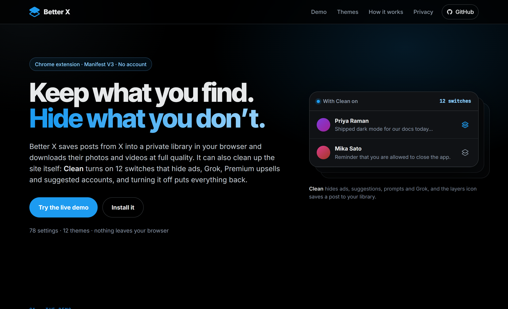
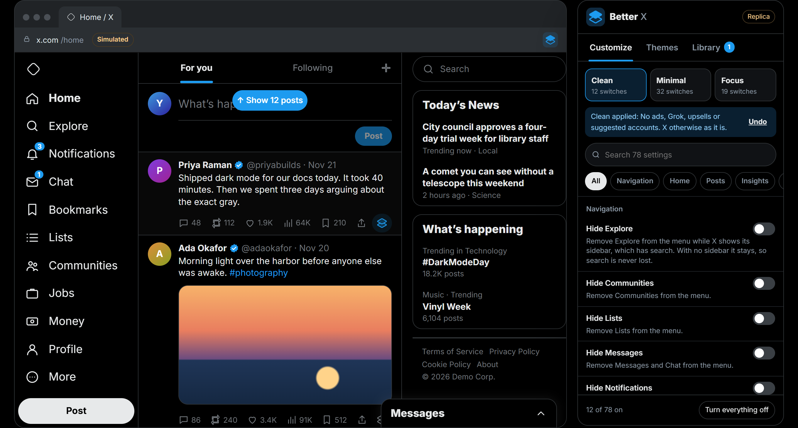
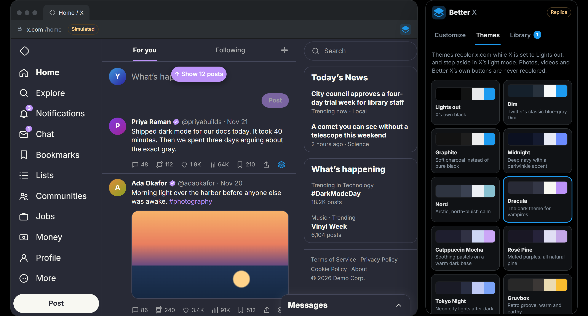
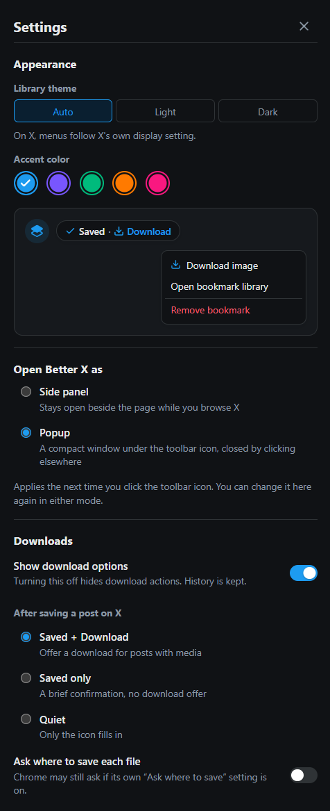

<div align="center">


# Better X

**Keep what you find. Hide what you don’t.**

A private, local-first Chrome extension for X. Save any post into a searchable library in your browser, download its photos and videos at full quality, and clean up the site itself: the **Clean** setup turns on 12 switches that hide ads, Grok, Premium upsells and suggested accounts.

[](https://github.com/ztxv/better-x/actions/workflows/check.yml)


### [**▶ Try the live demo at better-x-extension.vercel.app**](https://better-x-extension.vercel.app/)

[Install](#install) &nbsp;·&nbsp; [How it works](#how-it-works) &nbsp;·&nbsp; [Privacy](#privacy-and-permissions) &nbsp;·&nbsp; [Demo site](#demo-site)

</div>

<p align="center">
  
</p>

<p align="center">
  
</p>

<p align="center"><sub>Screenshots of the demo site. Its timeline is simulated: the accounts, posts, ads and trends are made up.</sub></p>

---

## About

Bookmarks on X are a pile you never go back to. Better X keeps the posts you care about in a proper library: searchable, tagged, sorted into collections, with private notes and the media saved to disk if you want it. It all lives in your browser, with no account, no server and no X API.

It grew out of Saved for X 0.2.0, and it also lets you adjust X itself from the same panel: hide the parts you never use, change widths and text sizes, and re-theme the whole site. Every customization starts off, and turning one off puts back exactly what was there.

## Features

- **One-click save.** A Save button in every post’s action row, sized and aligned to X’s own icons at any layout, zoom or font size. It captures the post as you see it: text, author, date, photos, videos, GIFs, the quoted post, what it replies to, and link or Article previews.
- **A real library.** A side panel with full-text search, author filter, date sort, collections, tags, private notes, bulk move/tag/delete with ten-second undo, and JSON export and validated import.
- **Original-quality downloads.** Photos at full resolution, GIFs as the MP4 files X hosts, and videos where X publishes an MP4. Multi-image posts open a chooser with **Download all**. Nothing downloads unless you click.
- **78 ways to customize X.** Navigation, home and feed, posts, account insights, smart filtering, sidebar, appearance, and ads / Grok / Premium. Changes apply to every open X tab at once, without reloading.
- **Quick setups.** **Clean**, **Minimal** and **Focus** apply a whole combination in one click, with Undo.
- **Themes for X.** Twelve presets (Dim, Graphite, Midnight, Nord, Dracula, Catppuccin Mocha, Rosé Pine, Tokyo Night, Gruvbox, Solarized Dark, Forest, Ember) plus your own. Secondary text and links stay at 4.5:1 contrast whatever colors you pick.
- **Account insights and Smart filtering** (off by default). Badges for where X says an account is based and how it connects, and the option to collapse, hide or highlight posts from accounts X places in countries you choose.
- **Plugins.** SpotifyControls puts a player above X’s account switcher, using your own Spotify app.
- **Open it your way.** Side panel, an overlay drawn inside the X tab, a compact popup, or a floating window. <kbd>Alt</kbd>+<kbd>Shift</kbd>+<kbd>B</kbd> toggles it.

## Install

Better X isn’t on the Chrome Web Store yet, so you build it and load it unpacked. You need Node.js 20.19+ and Chrome 116+.

```sh
git clone https://github.com/ztxv/better-x.git
cd better-x
npm ci
npm run build
```

1. Open `chrome://extensions` and turn on **Developer mode** in the top-right corner.
2. Click **Load unpacked** and select `.output/chrome-mv3`.
3. Pin Better X from the Extensions menu, then refresh any X tab that was already open.

After each rebuild, click **Reload** on the extension card and refresh X. The version on the card is the one in `wxt.config.ts`.

### Moving from Saved for X

Better X is a separate extension with its own library and doesn’t read Saved for X’s data on its own. Move your library with a backup file:

1. In **Saved for X**, open **Settings → Export JSON** and keep the file.
2. In **Better X**, open **Settings → Import JSON** and choose that file.

Every Saved for X backup version (1, 2 and 3) imports, along with Better X’s own backups. Bookmarks come across with their text, author, media previews, quoted post, reply and link card (as far as that version recorded them), plus collections, tags, notes, and completed download history, shown as **Downloaded previously**.

Saved for X’s settings don’t come across, so set them again. Files it downloaded stay in `Downloads/Saved-for-X`; Better X saves new ones to `Downloads/Better-X`. Nothing is copied automatically, and Saved for X keeps its own library until you remove it. Importing the same backup twice adds nothing, and a post already in Better X keeps its own notes, tags and collection.

## Using it


1. On x.com, click the layers icon in a post’s action row. The post is saved at once and the icon fills in.
2. For posts with media, a small chip offers **Download** for a few seconds. Hovering or focusing it keeps it open.
3. Click a saved post’s icon again for its menu: **Download**, **Open bookmark library**, **Remove bookmark**.
4. Click the toolbar icon to open the library. Use **Edit bookmark** for collections, tags and notes.
5. Open **Settings** (top right of the library) for appearance, downloads, menu options and data tools.

**Keyboard:** the icon and menus are ordinary buttons. <kbd>Tab</kbd> from the icon enters an open chip or menu, the arrow keys move between actions, and <kbd>Esc</kbd> closes it and returns focus to the icon.

<br clear="right">

## Customize X

The **Customize** tab, beside the Library, has 78 settings in eight groups. Search them, filter by group, and open or close groups. Nothing is removed from X’s page: settings hide or restyle things with CSS rules, so turning one off is instant and leaves nothing to undo.

- **Hide:** Ads, Grok, Premium upsells and suggested accounts; menu entries (Explore, Communities, Lists, Messages, Notifications, Bookmarks, Jobs, Premium, X Money, Articles and more); view, reply, repost, like and bookmark counts, follower counts, verification badges and X’s own action buttons (Better X’s Save stays); reposts, the Home composer and “Show new posts”.
- **Adjust:** sliders for timeline width, sidebar width, menu spacing, menu text size, post text size and profile picture shape; the system font; plain post text.
- **Twitter branding:** the classic bird as the tab icon (with the dot when you have notifications) and “Twitter” instead of “X” in the tab title. Switching either off puts X’s own back.
- **Drag to navigate photos:** drag a photo left or right in X’s photo viewer, and optionally right in the timeline.
- **Move your setup:** **Settings → Data & backup** exports your switches, sliders and theme to a small JSON file and imports it elsewhere (merge or replace). It’s separate from the Library backup.

Selectors come from Control Panel for Twitter and are checked against X-shaped test pages, not live x.com, so an X redesign can make a setting do nothing. It won’t hide ordinary posts. [docs/CONTROL-PANEL-INVENTORY.md](docs/CONTROL-PANEL-INVENTORY.md) lists what is and isn’t covered.

<p align="center">
  
</p>

## Themes

The **Themes** tab recolors x.com: X’s own **Lights out**, twelve presets, and **Custom**, where you set background, text and accent (plus raised, hover, border and secondary text under Advanced) with a live preview and readability warnings. One click switches every open X tab, with Undo.

- A theme applies while X is set to Lights out and steps aside completely in X’s light mode.
- The accent replaces X’s blue on links, tabs, buttons, switches, hover circles and the focus ring. Keep X’s own color (Settings → Display) on Blue, since X’s pink and green double as its like and repost colors.
- **Mentions and notifications** sets the color of @mentions, #hashtags and links, and the unread badge. Each follows the accent until you pick a color.
- **New theme** / **Save as new theme** keeps a palette under a name. Named themes can be renamed, duplicated, exported, imported and deleted.
- **Match Better X to my X theme** paints Better X’s own panel, popup and overlay with the active theme.
- Photos, videos and Better X’s own buttons are never recolored.

X’s class names for its surfaces live in one table, `src/themes/surfaces.ts`, checked against X’s own stylesheet with a console probe (`scripts/theme/probe.js`). A change on X’s side leaves a patch of X’s black, never unreadable text.

## Account insights and Smart filtering

Both are off by default.

- **Account insights** adds small badges after a post’s @handle, built from what X shows on a profile’s “About this account” page: a flag for the country or region the account is **based in**, an Apple / Android / Web mark for how it’s **connected**, and a note when X says the location may not be accurate. Click or point at a badge for a card with only the facts X sent.
- These are three different things, and Better X keeps them apart. _Based in_ is X’s estimate for the account, not nationality or where a post was written. _Connected via_ is the account’s platform, not the app used for one post. A location note is X’s, and isn’t proof of a VPN or of anything else.
- **Smart filtering:** choose countries or regions, and posts from accounts X places there are **collapsed** (with a Show post button), hidden, or highlighted. A quoted post is judged by its own author. **Always Show** accounts, your own posts, and the post you opened are never touched, and accounts X hasn’t answered for are never filtered. It changes only what you see.
- Lookups ask x.com with your own session, the way X’s own page does. They’re cached locally, shared between lookups of the same account, spaced out, and paused when X says to wait. By default nothing is looked up until you point at or click a badge’s globe; you can choose manual, on pointer rest, or automatic.

## Plugins

The **Plugins** tab holds larger additions, each with a description, a gear for its settings and a switch. A switch takes effect in every open X tab, and turning a plugin off removes everything it added.

**SpotifyControls** shows a player above X’s account switcher: cover (click it to enlarge it in place), title, artists, album, a seekable progress bar, and shuffle / previous / play-pause / next / repeat. Setup takes about two minutes and is shown in the plugin’s settings:

1. Open <https://developer.spotify.com/dashboard> and create an app (any name, tick **Web API**).
2. In the app’s settings, add the **Redirect URI** the plugin shows you (`https://<extension id>.chromiumapp.org/spotify`), exactly.
3. Paste the app’s **Client ID** into the plugin (never the secret, which isn’t used) and press **Connect Spotify**.

Limits that come from Spotify: playback controls need **Spotify Premium**; a new Spotify app is in development mode and works only for accounts listed under its User Management (yours by default); and the player controls whatever device is already playing. An unpacked extension’s id depends on the folder it’s loaded from, so if you move the folder, add the new Redirect URI to your Spotify app.

## Settings



| Setting               | Default                | Effect                                                     |
| --------------------- | ---------------------- | ---------------------------------------------------------- |
| Theme                 | Auto                   | Library theme. Menus on X follow X’s own display setting.  |
| Accent color          | Blue                   | Icon, focus rings and highlights, on X and in the library. |
| Show download options | On                     | Hides download actions when off. History is kept.          |
| After saving          | Saved + Download       | Offer a download, confirm only, or stay quiet.             |
| Ask where to save     | Off                    | Chrome’s own “Ask where to save” may still prompt.         |
| Saved-post menu       | Download, Open library | **Remove bookmark** is always available.                   |
| Open Better X as      | Side panel             | Side panel, popup (480, 580 or 600 px tall), or floating window. |
| Side panel on X       | Overlay                | Overlay keeps X where it is; Native lets X re-center.      |
| Tab on X’s right edge | Off                    | Overlay only: a small tab that opens the overlay.          |

**Overlay** (the default) draws the panel inside the X tab, over its right edge. Resize it by dragging its left edge (320 to 560 px, remembered), and close it with its Close button or <kbd>Esc</kbd>. **Native** is Chrome’s side panel, which narrows the page. Other sites always get Chrome’s side panel.

Resetting customization never touches your data. The Customize tab’s own switches, sliders and country choices are kept by that reset; **Turn everything off** at the bottom of the tab clears them.

<br clear="right">

## Media downloads

Files are saved with Chrome’s own downloader to `Downloads/Better-X/{handle}_{postId}_{n}.{ext}`. The extension never deletes a downloaded file.

| Media                                                     | Supported                    | How                                                                |
| --------------------------------------------------------- | ---------------------------- | ------------------------------------------------------------------ |
| Photos                                                    | Yes                          | Original resolution, in the format X serves.                       |
| GIFs                                                      | Yes                          | Saved as the MP4 X actually hosts.                                 |
| Videos, public posts                                      | Yes, when X publishes an MP4 | Looked up on demand from X’s public post-metadata endpoint.        |
| Videos on protected, deleted, age-restricted or withheld posts | No                      | Shows “Video unavailable to download” and a link to open the post. |
| Stream-only videos                                        | No                           | A preview image or playlist is never saved as a video.             |

A post enters the built-in **Downloaded** collection only when Chrome reports a download as complete, without leaving its own collection. Partial batches show as “2 of 4 downloaded” with a retry for the rest. Quoted-post media is listed separately and never downloaded silently. Removing a bookmark keeps its download history, and the library tells **File available locally** apart from **Downloaded previously**.

The video lookup uses an undocumented X endpoint, so it can change without notice. If it does, videos report as unavailable instead of failing silently, and photos and GIFs are unaffected. The evidence behind these choices is in [DEVELOPMENT.md](DEVELOPMENT.md#downloads).

## How it works

Built with [WXT](https://wxt.dev) (Manifest V3), React 19 and TypeScript in strict mode.

```text
entrypoints/
  background.ts      Message router and download events (service worker)
  content.ts         Content script on X: starts the runtime, then Saved
  sidepanel/         Library UI entry
src/
  runtime/           Shared X runtime: scopes, post stream, action row, routes, layout
  saved/             Save control, post-save chip, saved-post menu, downloads (on X)
  x/                 X DOM extraction and URL rules (all post selectors live in selectors.ts)
  storage/           IndexedDB connection and bookmark repository
  media/             URL rules, metadata adapter, media resolution
  downloads/         History store, lifecycle service, file naming, wording
  features/          The 78 customization features, their registry, CSS helpers and quick setups
  themes/            Theme presets, token derivation, X surface table
  insights/          Account insights badges, cards and country filtering
  plugins/, spotify/ The plugin host and SpotifyControls
  lib/               Settings, validation, sanitizers, messaging, backups
  sidepanel/         React components and styles
  content/           Overlay placement and styles for the X page
demo-site/           Static demo page (see below)
scripts/             Smoke tests, the perf harness, the theme probe, the demo engine build
```

1. **Find posts.** The runtime watches X’s timeline as it loads and gives each post’s action row a Save slot. It depends on test IDs and structure, never X’s generated class names.
2. **Save.** `src/x/selectors.ts` reads the post you clicked: text, author, date from the post id, media, quote, reply and link card. Saves are single IndexedDB transactions, so two tabs acting at once can’t overwrite notes, tags or history.
3. **Download.** The page asks for “media 2 of post N”. The background worker re-reads the saved post and derives every URL itself, so there’s no generic “fetch this URL” handler. It stores intent before asking Chrome, reconciles Chrome’s download ID, and never restarts anything on its own after a worker restart.
4. **Customize.** Each feature is a few CSS rules (and, for a few, a small piece of runtime behavior). Every rule that’s on goes into one `<style id="bx-features">`, rewritten whenever a switch or slider changes (`src/features/host.ts`).
5. **Theme.** `src/themes/derive.ts` turns three colors into 17 tokens with contrast guarantees, and `src/themes/css.ts` paints X’s surfaces from them.

See [DEVELOPMENT.md](DEVELOPMENT.md) for the full design, DOM assumptions and the download lifecycle, and [docs/ARCHITECTURE.md](docs/ARCHITECTURE.md) for the architecture decisions behind it.

## Privacy and permissions

**No account, analytics, telemetry or remote code.** All data lives in your browser. Exports contain metadata only, never media files or local file paths. Better X never stores or sends a cookie, token or header: account lookups read X’s `ct0` page token for the one request and keep nothing.

| Permission                                                                 | Why                                                                                                                                                                         |
| -------------------------------------------------------------------------- | --------------------------------------------------------------------------------------------------------------------------------------------------------------------------- |
| `storage`                                                                  | Settings, and a small change marker that keeps open tabs and the library in sync.                                                                                           |
| `sidePanel`                                                                | Open the library from the toolbar icon.                                                                                                                                     |
| `activeTab`                                                                | Read the address of the tab you click the toolbar icon on, only at that moment, so the overlay can tell an X tab from another site. No install warning, no standing access. |
| `downloads`                                                                | Save the media you choose and follow those downloads to completion. Other downloads are never read or recorded.                                                             |
| `x.com`, `twitter.com` (content script)                                    | Add the Save control and read only the post you save. With Account insights or filtering on, ask x.com (same origin, your own session) for an account’s public “About this account” data. |
| `pbs.twimg.com`, `video.twimg.com`, `cdn.syndication.twimg.com`            | Verify a chosen file and find a public post’s video. Contacted only when you click Download.                                                                                |
| `identity`                                                                 | Open Spotify’s own sign-in window when you connect the Spotify plugin. Unused otherwise.                                                                                    |
| `*.chromiumapp.org`                                                        | Only to notice a Spotify sign-in tab reaching its redirect address. Nothing is fetched from it.                                                                             |
| `api.spotify.com`, `accounts.spotify.com`, `*.scdn.co`, `*.spotifycdn.com` | The Spotify plugin only: what’s playing, playback commands, sign-in and cover art. Contacted only while that plugin is on and connected.                                     |

The Spotify plugin is the one place a sign-in is kept. Its tokens stay in this browser’s extension storage, are used only by the background worker to talk to Spotify, are never sent to X or put in a backup, and are removed by Disconnect. There’s no client secret. Cached account facts (public data X showed on profiles) stay on this device, aren’t part of any backup, and can be cleared in Customize → Account insights.

## Demo site

[`demo-site/`](demo-site) is a static page that runs Better X’s real feature catalog, quick setups, theme engine and post extractor against a simulated, X-shaped timeline, next to a working replica of the panel. It also has a theme lab where you pick three colors and see the tokens Better X derives. Nothing to install. **[Open the live demo →](https://better-x-extension.vercel.app/)**

To deploy your own copy, drag the `demo-site` folder onto [vercel.com/drop](https://vercel.com/drop), or use the button:

[](https://vercel.com/new/clone?repository-url=https%3A%2F%2Fgithub.com%2Fztxv%2Fbetter-x&root-directory=demo-site&project-name=better-x&repository-name=better-x)

| Setting               | Value       |
| --------------------- | ----------- |
| Root directory        | `demo-site` |
| Framework preset      | Other       |
| Build command         | None        |
| Environment variables | None        |

The demo loads `demo-site/engine/better-x-engine.js`, which is bundled from `src/` by `npm run demo:engine`. The unit tests fail if that file falls out of date. Details are in [`demo-site/README.md`](demo-site/README.md).

## Development

```sh
npm ci
npx wxt prepare   # once after a fresh clone: generates .wxt/tsconfig.json, which the tests need
```

```sh
npm run dev           # WXT dev build with reload; it prints the folder to load
npm run check         # type-check
npm test              # unit tests (also run in CI)
npm run build         # production build to .output/chrome-mv3
npm run smoke         # real-Chrome end-to-end tests (network required)
npm run demo:engine   # rebuild the demo site's engine bundle from src/
npm run demo:serve    # serve demo-site/ locally
npm run format        # Prettier
```

**Unit tests (Vitest)** cover DOM extraction, URL rules, the metadata adapter against recorded responses, media resolution, the download lifecycle with a scripted `chrome.downloads`, repository atomicity, settings migrations, backup round-trips, the feature registry and catalog, slider values, quick setups, themes, account insights, plugins, the Customize view, and the demo engine’s drift check.

**End-to-end (`npm run smoke`)** loads the unpacked build in your installed Chrome against X-shaped pages, then saves and downloads real media from X’s CDNs. It covers photos, GIFs, a blob-player video, partial batches, quoted media, keyboard use, placement, two tabs saving at once, live settings, dark theme, reduced motion, and stopping the worker mid-download. Further runs check every customization on an X-shaped catalog page (what each hides and what it must leave alone), reloading the extension under an open tab, the launch modes, insights, themes, the overlay, photo dragging and plugins. They don’t use a signed-in X account, so verify on real x.com after changing selectors or media handling.

<details>
<summary><b>Known limits</b></summary>

<br>

- The library stores links, metadata and thumbnail URLs, not offline copies. Thumbnails stop loading if X removes the media.
- Video downloads depend on an undocumented X endpoint and don’t cover protected or withheld posts.
- Only downloads started by this extension are tracked.
- One collection per bookmark; tags can be multiple.
- No sync between browsers. Use JSON export and import to move a library.
- X’s markup changes over time and may need selector updates.
- Account insights read X’s internal `AboutAccountQuery`. It couldn’t be tried against live x.com in automated tests (X refuses automated browsers). If X changes the query id, headers or response, the badges and the country filter stop working, and nothing is shown or filtered. See [docs/MANUAL-CHECKLIST.md](docs/MANUAL-CHECKLIST.md).
- Flags are Unicode flag glyphs, so Windows shows two letters (for example “DE”) instead of a flag.
- The post’s own client (“Twitter for iPhone”) isn’t shown; see [docs/ARCHITECTURE.md](docs/ARCHITECTURE.md).
- The overlay covers the right edge of X (on a narrow window, part of the timeline). That’s the trade for X not moving; use Native to have X make room instead. If the toolbar icon is clicked on a tab that left X while the overlay owned it, and that click is what woke the background worker, the click does nothing (Chrome only opens a side panel inside the click); the next one opens it.

</details>

<details>
<summary><b>What’s new</b></summary>

<br>

**1.3.5**

- Exporting bookmarks or customization settings opens a Save As window with a clear name (`better-x-bookmarks-DATE.json`, `better-x-customizations-DATE.json`). Files exported by 1.3.0 and earlier import unchanged.
- The Spotify cover enlarges inside the player. Click again or press Esc to shrink it.

**1.3.0**

- **Also drag photos in the timeline**, under Drag to navigate photos.
- **Mentions and notifications** colors in the theme editor.
- **Match Better X to my X theme.**
- Hide “Who to follow” no longer leaves an empty box.
- Spotify connects from the background worker, with a normal-tab fallback when Chrome’s sign-in window can’t open.

**1.2.0**

- Plugins, your own themes, and drag to navigate photos.

</details>

## Roadmap

None of these are built yet.

- **Chat themes:** theming X’s Chat, which lives in shadow DOM where page styles can’t reach (partly built, switch hidden for now).
- **More X customization** that needs X’s internals (feature flags, React state, network responses), such as separated reposts, sorting, and restoring the post source and counts. Listed in [docs/CONTROL-PANEL-INVENTORY.md](docs/CONTROL-PANEL-INVENTORY.md); design in [docs/ARCHITECTURE.md](docs/ARCHITECTURE.md).
- Indexed search for very large libraries.
- Optional sync, opt-in only.

## License

[MIT](LICENSE). Third-party credits, including Control Panel for Twitter and Dim Mode for Twitter / X, are in [THIRD_PARTY_NOTICES.md](THIRD_PARTY_NOTICES.md).

## Disclaimer

Better X is an independent project. It is not affiliated with, endorsed by or connected to X Corp. or Spotify. “X” and “Twitter” are trademarks of their respective owners.

<div align="center">
<sub>Built by <a href="https://github.com/ztxv">@ztxv</a>.</sub>
</div>
